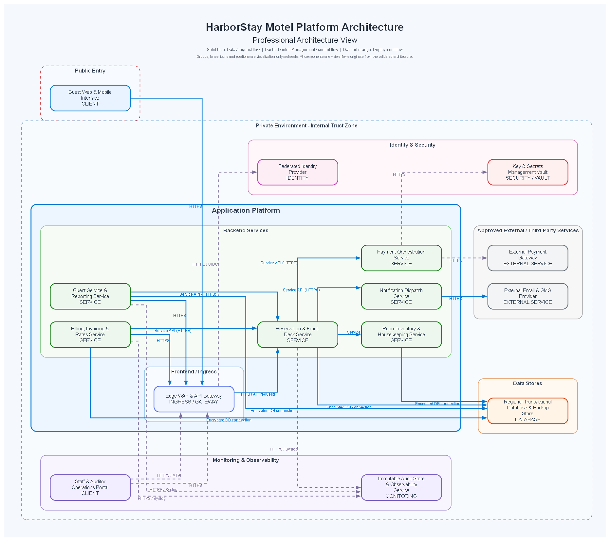

# AI Threat Modeling Engine

[](https://www.python.org/)
[](https://learn.microsoft.com/azure/security/develop/threat-modeling-tool-threats)
[](schemas/architecture.schema.json)
[](#license)

## Overview

AI Threat Modeling Engine turns a requirements PDF into a traceable system architecture, validates its structure and requirement references, and generates Data Flow Diagrams (DFDs), STRIDE threats, security controls, and review artifacts. A local web workbench supports human review of candidate architecture changes and approval of a specific architecture hash.

The project addresses the gap between prose requirements and security review: requirements, architecture components and flows, coverage, and threats are produced through one repeatable workflow rather than maintained as disconnected documents.

## End-to-End Pipeline Architecture

1. **PDF ingestion and requirement extraction** — extract text from a selected PDF and use a local Ollama model to identify functional (`FR`), non-functional (`NFR`), security (`SEC`), and compliance (`COM`) requirements.
2. **Trust-zone graph synthesis** — synthesize an architecture JSON graph with nodes, flows, and trust-zone boundaries (the HarborStay example uses `TZ-1` through `TZ-6`).
3. **Deterministic validation and coverage** — validate requirement IDs and graph references, then calculate node/edge coverage. The current coverage implementation reads `requirement_ids`; `satisfies_requirements` is represented in the sample/schema but is not yet a coverage input.
4. **Human-in-the-loop review and approval** — stage constrained graph changes as previews, inspect diffs, accept or discard candidates, and approve a specific architecture SHA-256 hash.
5. **STRIDE and report generation** — generate DFD, STRIDE threat, security-control, presentation, and diagram artifacts.

The pipeline runner has nine scripted stages: PDF extraction, AI requirements analysis, requirements validation, architecture synthesis, architecture validation, coverage reporting, STRIDE threat modeling, presentation metadata, and diagram rendering. It then initializes the review workflow and downstream artifacts.



*HarborStay Motel Platform sample architecture. An editable vector version is available at [harborstay-architecture.svg](docs/diagrams/harborstay-architecture.svg).*

## Key Features

- **Traceability and validation:** deterministic coverage reports map requirements through node/edge `requirement_ids`; validators detect missing and unknown references.
- **Constrained review patches:** architecture proposals use a defined operation set and allowed-field lists. Candidates are previewed and checked for unintended changes before acceptance.
- **Human approval gate:** explicit reviewer confirmation binds approval to the displayed SHA-256 hash of the architecture.
- **Local model integration:** requirement extraction, architecture synthesis, and AI-assisted review use Ollama's local HTTP API, with `qwen3:4b` as the default preference.
- **Explicit data-flow model:** trust zones, protocols, authentication, encryption, and boundary-crossing metadata are represented in architecture JSON.
- **Policy limitations:** the HarborStay example states that raw card data is not stored, but the current code does not provide a general-purpose excluded-component policy engine. Exclusion requirements should be reviewed and validated explicitly; do not treat the sample assumption as an automated enforcement guarantee.
- **No separate frontend build:** the workbench UI is an HTML/CSS/JavaScript SPA embedded in `backend/app.py`; it is served by the Python standard-library HTTP server.

## Project Directory Structure

```text
.
├── backend/
│   ├── app.py
│   ├── architecture_ai.py
│   ├── architecture_diagram.py
│   ├── architecture_review_workflow.py
│   ├── coverage_report.py
│   ├── dfd_generator.py
│   ├── ollama_test.py
│   ├── ollama_utils.py
│   ├── pdf_test.py
│   ├── presentation_model.py
│   ├── professional_architecture_diagram.py
│   ├── requirements_ai.py
│   ├── run_pipeline.py
│   ├── security_controls.py
│   ├── stride_engine.py
│   ├── threat_model_ai.py
│   ├── tm7_exporter.py
│   ├── validate_architecture.py
│   ├── validate_requirements.py
│   ├── outputs/
│   │   ├── architecture_v1.json
│   │   ├── requirements.json
│   │   └── presentation/
│   │       └── presentation_v1.json
│   └── uploads/
│       └── .gitkeep
├── docs/
│   └── diagrams/
│       ├── harborstay-architecture.png
│       └── harborstay-architecture.svg
├── samples/
│   ├── architectures/
│   │   └── harborstay-architecture.json
│   ├── outputs/
│   │   ├── harborstay-coverage-report.json
│   │   ├── harborstay-dfd.json
│   │   ├── harborstay-requirements.json
│   │   ├── harborstay-stride-threats.json
│   │   └── harborstay-threat-model.json
│   └── requirements/
│       ├── AI_Threat_Modeling_Test_Requirements.pdf
│       ├── Motel_Management_Platform_Test_Requirements.pdf
│       └── System_Requirements_Azure_Kubernetes_Architecture-1.pdf
├── schemas/
│   └── architecture.schema.json
├── .gitignore
├── README.md
└── requirements.txt
```

The workbench UI is embedded in `backend/app.py`; there is no separate frontend source/build directory. Generated files under `backend/outputs/` and user uploads under `backend/uploads/` are local runtime data; only starter input files are tracked.

## Prerequisites & Installation

- Python 3.10 or later
- [Ollama](https://ollama.com/) for AI-assisted pipeline stages
- Graphviz installed with its `dot` executable available for diagram rendering

Clone and install:

```powershell
git clone https://github.com/coldsmoke07/Ai-threat-modeling-engine.git
cd Ai-threat-modeling-engine
py -3 -m venv .venv
.\.venv\Scripts\Activate.ps1
python -m pip install --upgrade pip
python -m pip install -r requirements.txt
```

On macOS/Linux, activate the environment with:

```bash
python3 -m venv .venv
source .venv/bin/activate
python -m pip install --upgrade pip
python -m pip install -r requirements.txt
```

Install and start Ollama, then pull the default model:

```bash
ollama pull qwen3:4b
```

The backend calls Ollama at `http://localhost:11434` and selects an installed model from its preference list. No `.env` file or cloud LLM API key is required by the current code. Graphviz is a separate system dependency; the Python `graphviz` package alone does not install the `dot` executable.

## Usage & Quick Start

### Run the web workbench

From the repository root, with the virtual environment active:

```powershell
python backend\app.py
```

The server binds to `127.0.0.1:8081` by default and opens a browser. Use `--no-browser` to suppress that behavior or `--host` / `--port` to override the bind address:

```powershell
python backend\app.py --no-browser --port 8081
```

The app implements a local JSON API, including `GET /api/state` and `POST` routes for PDF upload, pipeline execution, requirement entry, diagram import, candidate feedback, preview acceptance/discard, approval, and downstream generation. It also exposes generated architecture, DFD, coverage, STRIDE, controls, and TM7 artifacts under `/artifact/...`. The application is intended for local use; do not expose this unauthenticated development server to an untrusted network.

### Run the pipeline

Copy a sample PDF into the runtime upload directory, then select it with the active-PDF marker:

```powershell
New-Item -ItemType Directory -Force backend\uploads | Out-Null
Copy-Item samples\requirements\Motel_Management_Platform_Test_Requirements.pdf backend\uploads\
Set-Content -NoNewline backend\outputs\active_pdf.txt "Motel_Management_Platform_Test_Requirements.pdf"
python backend\run_pipeline.py --skip-server
```

This runs all nine generation stages and initializes the review state without starting the web server. To run the pipeline and then launch the interactive server, omit `--skip-server`. The model-dependent stages require Ollama to be running with a model installed.

### Validate the included HarborStay starter data

```powershell
python backend\validate_requirements.py
python backend\validate_architecture.py
python backend\coverage_report.py
```

Optional connectivity check:

```powershell
python backend\ollama_test.py
```

The repository includes executable validation scripts rather than a configured `pytest` suite.

## Sample Walkthrough

The sample input is [Motel_Management_Platform_Test_Requirements.pdf](samples/requirements/Motel_Management_Platform_Test_Requirements.pdf). The checked-in HarborStay example contains 12 functional, 7 non-functional, and 11 security/compliance requirements. Running the pipeline produces:

- a validated architecture graph: [harborstay-architecture.json](samples/architectures/harborstay-architecture.json)
- requirement and coverage results: [HarborStay sample outputs](samples/outputs/)
- STRIDE/threat artifacts: [harborstay-stride-threats.json](samples/outputs/harborstay-stride-threats.json) and [harborstay-threat-model.json](samples/outputs/harborstay-threat-model.json)

The generated architecture is validated against requirement IDs and graph references before review. Reviewers inspect the proposed diff, accept or discard it, and explicitly approve the architecture hash before treating it as approved.

## License

No license has been specified in this repository yet. All rights and redistribution terms should be confirmed by the project owner before reuse.
